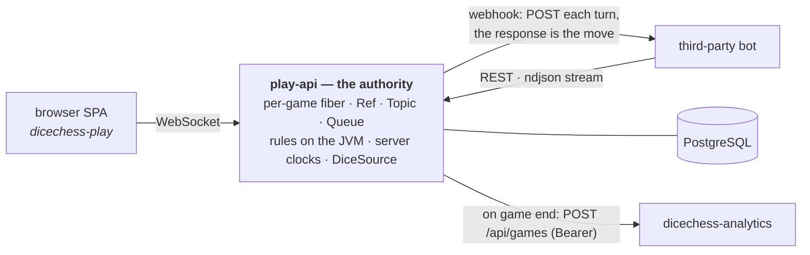

# Dice Chess Play API 🎲♟️

[](https://github.com/fortemate/dicechess-play-api/actions/workflows/ci.yaml)
[](https://fortemate.com/)
[](./LICENSE)

Authoritative real-time server for **Dice Chess** — human-vs-human play, a third-party **Bot API**, and an automatic **Glicko-2 rating ladder**.

> **Status: live.** Authoritative HvH over WebSocket, the full Bot API (REST + ndjson event streams + webhooks), PostgreSQL durability with crash recovery, analytics hand-off, and a continuously-paired Glicko-2 rating ladder.

## Architecture

Scala 3 · cats-effect · http4s (Ember), reusing the **dice-chess rules on the JVM** (`com.fortemate:dicechess-rules`, the rules half of the engine) so move legality and rules never drift from the client. The search half of the engine is a test-only dependency: it plays the sparring opponents in the suites and never enters the server.



**Transport-agnostic player — the core principle.** A `GameRoom` does not know whether a player is a human over WebSocket or a bot over HTTP. A player is *something that receives game events and submits commands*, identified by a `Principal` and seated at a `Seat`. The website WS and the Bot API are two thin adapters over the same room — the game logic is written once and is identical for human-vs-human, human-vs-bot, and bot-vs-bot.

### Dice fairness

The **server** generates dice (CSPRNG), wrapped in **commit-reveal** so every roll is provably fair after the fact, behind a swappable `DiceSource` interface. No client ever rolls.

### Bot API

Third-party bots connect via a dedicated API — a token plus any of three connection modes: REST polling, an ndjson event stream, or a single serverless **webhook** (the server POSTs each turn, the HTTP response is the move). Language-agnostic and reconnect-safe.

## Documentation

- **[Bot API](https://bots.fortemate.com/)** — connect a bot in minutes: REST, streaming, or one serverless webhook; OpenAPI reference included.
- **[Contributor docs](https://fortemate.github.io/dicechess-play-api/)** — how the server is built: architecture, database schema, concurrency doctrine, testing conventions.
- [`CONTRIBUTING.md`](./CONTRIBUTING.md) for the pull-request workflow and [`SECURITY.md`](./SECURITY.md) for reporting vulnerabilities.

## Quick Start

### Prerequisites

- [mise](https://mise.jdx.dev/) (manages Java, sbt, scalafmt, and developer tools)
- PostgreSQL (or run via Docker / Testcontainers)

```bash
mise run setup       # Install dependencies & register git hooks
mise run compile     # Compile Scala sources
mise run test        # Run unit & integration tests
mise run check       # Run the full CI quality gate locally
mise run run         # Start local server on :8080
```

## License

Licensed under the [GNU Affero General Public License v3.0](./LICENSE).

## Rating epoch operator workflow

`mise run rating:epoch -- plan` builds an immutable rating plan from local files. It does not connect to a database. This planner is separate from `rating:replay`: the legacy replay is an arithmetic audit, not authority to reclassify historical games under the matrix policy.

```bash
mise run rating:epoch -- plan config=config.json source=source.jsonl artifacts=artifacts out=epoch-plan
```

The output directory must not exist. A successful export contains `plan.json`, `plan.sha256`, and a streamed `ledger.jsonl`. Exit code 3 means the ledger and plan were exported for inspection, but the plan is not activatable. Structural, source-hash, or evidence failures never publish `plan.json`; no existing output is overwritten.

The Config and SourceGame contracts are defined in [`RatingEpochPlan.scala`](src/main/scala/dicechess/play/rating/migration/RatingEpochPlan.scala); the filesystem fixture in [`RatingEpochMigrationMainSuite.scala`](src/test/scala/dicechess/play/rating/migration/RatingEpochMigrationMainSuite.scala) demonstrates complete synthetic input. Config is a JSON object, source is UTF-8 JSONL, and `config.sourceSha256` is SHA-256 of the exact source bytes, including whitespace and line endings. Source rows must be ascending by `(finishedAt, gameId)`. Tied mutating games require an explicit, audited sequence; a timestamp tie is not evidence of application order. The planner bounds source rows and equal-time groups, and the CLI limits config/evidence documents to 1 MiB and each JSONL line to 1,048,576 characters. Serialized plans have a separate 512 MiB ceiling for larger participant pools; loading/staging retains the plan and JSON representation in memory, so provision RAM beyond the serialized size. The per-reconstruction evidence cache retains at most 32 verified artifacts and checks role/game scope on every use. Use paths without spaces, shell quotes, backslashes, or semicolons through the Bash wrapper.

Every supplied classification, continuity, ownership, order, or reset artifact hash must resolve to an actual file at `artifacts/<sha256>.json`, whose exact UTF-8 bytes match that hash. An evidence document has these fields:

```json
{
  "formatVersion": 1,
  "acceptedBy": "reviewer-identity",
  "statement": "The reviewed historical assertion and its supporting evidence.",
  "roles": ["classification", "continuity", "ownership", "order"],
  "gameIds": ["source-game-id"],
  "targetEpoch": null
}
```

The CLI checks format, hash, declared role, and exact game scope. The human acceptance must vet the statement and underlying historical assertions; merely creating a matching file or hash does not prove past ownership, identity continuity, or application order. Account IDs and historical bot incarnation UUIDs must use their canonical representation, so database UUID casts cannot alias distinct ledger identities. Missing evidence becomes an explicit unknown ledger decision and blocks rebuild activation. Current registrations, ownership, ratings, and anchor values are never substituted for missing history. Recorded training references remain captured values and only update the human training projection; competitive updates affect both seats. Categories and domains remain separate.

An approved reset is a distinct mode with an empty projection, not a partial rebuild that discards unknowns. Set `config.approvedReset` to `{ "reason": "...", "approvedBy": "...", "artifactSha256": "..." }` only after explicit human acceptance. Its separate artifact must include the `reset` role, the exact `targetEpoch`, identical reviewer and reason, `sourceSha256`, `modelVersion`, `anchorSetVersion`, `databaseSourceSha256`, and `scope: "all-rating-domains-and-categories"` matching Config. Create this reset approval after the source file exists; row-proof artifacts must not depend on the hash of the source that references them. The final accepted plan hash is recorded outside its referenced approval artifact, avoiding a circular hash. The planner records reset decisions for the source rows.

Database commands are explicit operator actions against a separately selected, schema-ready database. The target epoch must exceed every previously used or saved-history epoch; epoch numbers are never reused, including after rollback. They do not run Flyway, application startup, or background jobs. Supply connection settings through `PLAY_DB_URL`, `PLAY_DB_USER`, and `PLAY_DB_PASSWORD`; credentials are never CLI arguments or printed status fields. Install the schema separately before using these commands. Prepare and verify the workflow on an isolated database before any human-operated production cutover.

```bash
mise run rating:epoch -- probe
mise run rating:epoch -- pause revision=EXPECTED_REVISION
mise run rating:epoch -- probe
mise run rating:epoch -- stage plan=epoch-plan/plan.json source=source.jsonl artifacts=artifacts revision=EXPECTED_REVISION source-sha256=EXPECTED_DATABASE_SOURCE_HASH plan-sha256=ACCEPTED_PLAN_HASH
mise run rating:epoch -- status run=RUN_UUID
mise run rating:epoch -- probe
mise run rating:epoch -- activate run=RUN_UUID revision=EXPECTED_REVISION plan-sha256=ACCEPTED_PLAN_HASH
mise run rating:epoch -- probe
mise run rating:epoch -- resume revision=EXPECTED_REVISION
```

Replace the uppercase placeholders with independently inspected values from the immediately preceding status/probe and accepted plan artifact. The database source fingerprint is distinct from the source JSONL byte hash. Before generating the final accepted plan, set `config.databaseSourceSha256` to the fresh paused probe fingerprint; CLI stage requires this exact binding. A later source/lifecycle change requires a newly inspected probe and a new config/plan, rather than changing epoch or cutoff merely to obtain a different hash. Stage replays the supplied source and verifies its evidence again before handing the plan to the executor. Database mutations compare the expected revision; activation additionally checks the accepted plan hash and preserved source/lifecycle state. The pause flag fences rating writes only. Before activation the human operator must stop all serving traffic, drain in-flight HTTP requests and games, and stop every writer, control-plane process, and snapshot publisher; pause alone is not full quiescence. Keep the original pause in place throughout acceptance and any fast rollback. Inspect stage and activation status before resuming writers. Do not retry a stale revision by guessing a new number.

Fast rollback is available only while the original pause is still held and its accepted revision/lifecycle/source state remains unchanged. Probe without toggling pause, then explicitly run `mise run rating:epoch -- rollback run=RUN_UUID revision=EXPECTED_REVISION` with the accepted activation revision. Once any resume/pause cycle or legitimate write has advanced the revision, this fast rollback must refuse: prepare a human-reviewed catch-up or recovery plan instead of overwriting later work. Inspect the returned status and probe before any resume. No rating-epoch command is invoked automatically by deploys or server startup.
